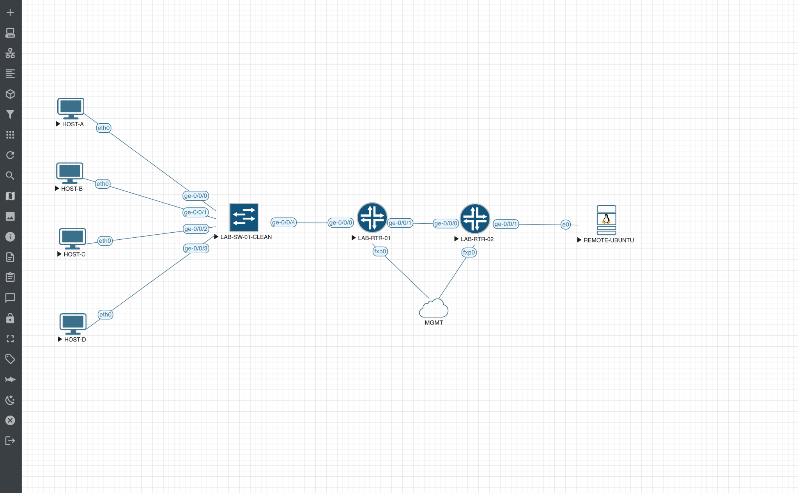

# Two-Router Static Routing Lab

## Objective

Build a small routed path from the lab switch and host VLANs through two Juniper routers to a remote Linux endpoint. Use interface state, routing tables, next hops, and connectivity tests to understand which part of the path is working.

**Status:** active learning and validation. Route entries and a local gateway test have been observed; further end-to-end testing and packet-loss troubleshooting remain.

## Topology



This EVE-NG snapshot shows four hosts connected to `LAB-SW-01-CLEAN`, the switch linked to `LAB-RTR-01`, R1 linked to `LAB-RTR-02`, and R2 linked to `REMOTE-UBUNTU`. The `fxp0` management interfaces connect to `MGMT` separately from the lab data path. A topology image shows intended connections; it does not verify interface state or forwarding.

| Connection | Interface at first device | Interface at second device |
|---|---|---|
| HOST-A to switch | `eth0` | `ge-0/0/0` |
| HOST-B to switch | `eth0` | `ge-0/0/1` |
| HOST-C to switch | `eth0` | `ge-0/0/2` |
| HOST-D to switch | `eth0` | `ge-0/0/3` |
| Switch to R1 | `ge-0/0/4` | `ge-0/0/0` |
| R1 to R2 | `ge-0/0/1` | `ge-0/0/0` |
| R2 to REMOTE-UBUNTU | `ge-0/0/1` | EVE interface `e0` / guest `ens3` |

The screenshot records links, not switch port VLAN membership or individual HOST-A through HOST-D IP settings. Those details require separate configuration evidence.

## Addressing observed in the lab

| Device | Interface | Address or role | Evidence |
|---|---|---|---|
| R1 | `ge-0/0/0.10` | `10.10.10.1/24`, VLAN 10 gateway | R1 configuration backup |
| R1 | `ge-0/0/0.20` | `10.10.20.1/24`, VLAN 20 gateway | R1 configuration backup |
| R1 | `ge-0/0/1.0` | `10.255.0.1/30` | Interface and connected-route output |
| R2 | `ge-0/0/0.0` | `10.255.0.2/30` | Transit addressing and R1 next-hop evidence |
| R2 | `ge-0/0/1.0` | `10.20.20.1/24` | Remote-LAN and host gateway evidence |
| REMOTE-UBUNTU | `ens3` | `10.20.20.10/24`; gateway `10.20.20.1` | Linux route and local gateway test screenshot |

## Remote routes

| Router | Destination prefix | Route type | Next hop | Egress |
|---|---|---|---|---|
| R1 | `10.20.20.0/24` | Static | `10.255.0.2` | `ge-0/0/1.0` |
| R2 | `10.10.10.0/24` | Static | `10.255.0.1` | `ge-0/0/0.0` |

These next hops are on the shared `10.255.0.0/30` transit network. A route to VLAN 20 on R2 is not documented as verified in this record.

### R1 observed route

```text
10.20.20.0/24  *[Static/5]
                 > to 10.255.0.2 via ge-0/0/1.0
```

### R2 observed return route

```text
10.10.10.0/24  *[Static/5]
                 > to 10.255.0.1 via ge-0/0/0.0
```

These excerpts record the relevant route entries reported during the lab, not full raw device exports. An active route is evidence of a forwarding decision; it does not alone establish that every device responds or that the return path is healthy.

## Validation so far

- The Ubuntu host showed a default route through `10.20.20.1` on `ens3`.
- Ubuntu sent four ICMP probes to that local gateway and received four responses with 0% packet loss.
- R2 showed `10.20.20.0/24` as directly connected.
- R2's return route to `10.10.10.0/24` was active via R1.
- In one R2-to-`10.10.10.10` ping test, 8 of 26 probes received replies, with 69% packet loss. The cause is not established.

See [validation notes and screenshot](../../validation-outputs/static-routing/README.md). No completed traceroute or clean end-to-end tests for both VLANs are claimed here.

## Next validation steps

1. Verify current interface status, addressing, switch VLAN membership, and host default gateways.
2. Recheck both static routes and the route needed for VLAN 20 if that VLAN is part of the test.
3. Isolate the observed packet loss and repeat tests with recorded source, destination, and results.
4. Run and document traceroute after basic reachability is stable.
5. Export sanitized configurations and outputs; keep credentials and full sensitive backups private.

## Related work

- [Read-only Junos PyEZ backup](../../automation/junos-pyez/README.md)
- [Earlier cloud-hosted vSRX phase](../phase-1/README.md)
