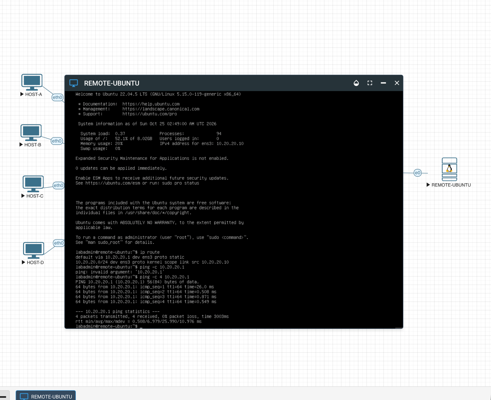

# Static Routing Validation Evidence

## Ubuntu local gateway test



The screenshot shows `REMOTE-UBUNTU` with address `10.20.20.10`, a default route via `10.20.20.1` on `ens3`, and a ping to that local gateway:

```text
default via 10.20.20.1 dev ens3 proto static
10.20.20.0/24 dev ens3 proto kernel scope link src 10.20.20.10

ping -c 4 10.20.20.1
4 packets transmitted, 4 received, 0% packet loss
```

**Proves:** the host had the displayed route and received replies from its local gateway in this test.

**Does not prove:** reachability across R1 and R2 to the host VLANs, stable forwarding over time, or traceroute behavior.

## Router route observations

R1 selected `10.20.20.0/24` as a static route via `10.255.0.2`, exiting `ge-0/0/1.0`. R2 selected the return route for `10.10.10.0/24` via `10.255.0.1`, exiting `ge-0/0/0.0`. The relevant entries are reproduced in the [build record](../../documentation/static-routing/README.md); a full raw device export is not included here.

## Packet-loss observation

A test from R2 to `10.10.10.10` received 8 of 26 responses, a reported 69% packet loss. This is partial connectivity, not a passing reliability test. The root cause was not established in the retained evidence.
